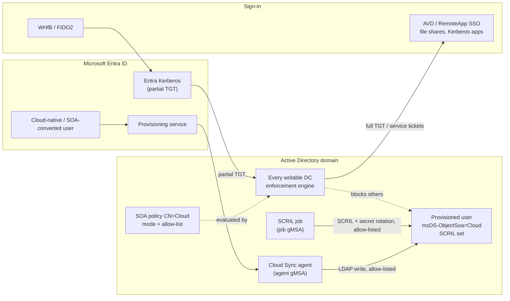

# cloudsync-ad-enforcement-toolkit

PowerShell toolkit and consolidated findings for running **Microsoft Entra Cloud Sync – user provisioning from Entra ID to Active Directory** together with **AD object enforcement**. Both features are in preview. The goal is that cloud-first users (users created in Entra ID, and users whose source of authority was converted to the cloud) keep signing in to AD resources **passwordless**: Windows Hello for Business or FIDO2 via Cloud Kerberos Trust, plus Azure Virtual Desktop / RemoteApp SSO. The toolkit also prevents an expired AD password from silently breaking those sign-ins.

> **Status: 1.0.0 (2026-10-19).** Both Microsoft features are in **preview**, and their behavior and documentation can change. This is an independent community project. It is not affiliated with or endorsed by Microsoft. Validate everything in a lab first; there is no warranty of any kind. Facts are labeled **Documented**, **Observed** or **Inferred** (see [Key findings](#key-findings)).

---

## Contents

- [Why this toolkit exists](#why-this-toolkit-exists)
- [Architecture](#architecture)
- [Repository layout](#repository-layout)
- [Terminology](#terminology)
- [Prerequisites](#prerequisites)
- [Rollout](#rollout)
- [Key findings](#key-findings)
- [SCRIL, password expiry and automatic rolling](#scril-password-expiry-and-automatic-rolling)
- [Upstream issues in Microsoft's scripts and documentation](#upstream-issues-in-microsofts-scripts-and-documentation)
- [Open questions and verification status](#open-questions-and-verification-status)
- [Changelog](#changelog)
- [References](#references)
- [License](#license)

---

## Why this toolkit exists

1. Users provisioned by Cloud Sync to AD **have no usable AD password**. Password writeback is not available, and Microsoft's intended sign-in path to Kerberos resources is passwordless (WHfB / FIDO2 with Cloud Kerberos Trust). *(Documented)*
2. An **expired AD password blocks** FIDO2 and WHfB Cloud Kerberos Trust sign-in. *(Documented)* Users who never change a password would therefore eventually lose AD access.
3. *Smart card is required for interactive logon* (**SCRIL**) takes accounts out of the password-expired state. However, Cloud Sync does not let you set it through an attribute mapping *(Observed)*, and automatic secret rolling interacts with `maxPwdAge` *(Documented)*.
4. **AD object enforcement** blocks LDAP changes to marked objects for every identity that is not in the policy allow-list, Domain Admins included. All automation (SCRIL, rotation) must run as an allow-listed identity with least-privilege ACLs.
5. Several statements in Microsoft's documentation do not match the behavior of the accompanying scripts (see [Upstream issues](#upstream-issues-in-microsofts-scripts-and-documentation)).

## Architecture



## Repository layout

All scripts live in `scripts/` and share `SoaEnforcement.config.psd1` from the same folder.

| Script | Purpose | Writes? |
|---|---|---|
| `Test-SoaEnforcementPrereqs.ps1` | Pre-flight for every writable DC: OS and `ntdsai.dll` minimum, KIR enablement (registry override + RSoP), restart state, PDC emulator, `SOA-Policies` container per DC incl. originating DC, replication, event logging. Produces CSV / JSON / HTML. | No |
| `Set-NtdsSecurityDiagnosticsGpo.ps1` | GPO that sets `NTDS\Diagnostics\2 Security Events = 1` on all DCs. Toggled by the link state; the value is removed when the GPO no longer applies. | GPO only |
| `Get-SoaEnforcementImpact.ps1` | Lists the marked users/groups and the provisioned objects that are not marked. Classifies everyone who changed marked objects in the last *n* days: allowed / DC-internal / **would be blocked**. | No |
| `Initialize-SoaEnforcement.ps1` | Rollout steps: job gMSA, least-privilege delegation, break-glass account, allow-list maintenance (with SID validation), deployment of the SCRIL job, verification (replication + event 3095), **mode switch Audit ↔ Enforced**. | Yes |
| `Invoke-ScrilJob.ps1` | Runs as the job gMSA: sets SCRIL (`Enforce`), rotates secrets (`Rotate`, metadata-verified), and executes controlled test actions on the TestUser (`Test`). | Yes |
| `Test-ScrilBehavior.ps1` | Measures SCRIL / PNE / deny-change / toggle / random reset / automatic rolling / `maxPwdAge` behavior in your domain (inventory, UI observation, 17-step matrix, rolling observation) and builds a consolidated report. | TestUser only |
| `Watch-CloudUserPasswordless.ps1` | Monitoring (exit code 0/1/2) and validation tests for passwordless readiness of all provisioned users plus the infrastructure. | Test mode only |
| `SoaEnforcement.config.psd1` | Shared configuration. Values are placeholders (`contoso.com`). | – |

`docs/Consolidated-Findings.pdf` is an English summary of the findings.

## Terminology

The scripts, reports and this README use these terms consistently.

| Term | Meaning |
|---|---|
| **Provisioned user** | AD user created or matched by Cloud Sync; `msDS-ExternalDirectoryObjectId` starts with `User_` |
| **Cloud-native** / **SOA-converted** | Origin heuristic: the anchor was stamped within 10 minutes of object creation (created by provisioning) or later (pre-existing object matched after a source-of-authority conversion) |
| **Marked** | `msDS-ObjectSoa` is set (default user mapping: constant `Cloud`); the enforcement policy applies only to marked objects |
| **SOA policy** | Object `CN=Cloud,CN=SOA-Policies,CN=System,<domain>`; `keywords` = **enforcement mode** (`Audit` / `Enforced`), `msDS-Settings` = **allow-list** (SIDs) |
| **Enforcement engine** | DC-side component (cumulative update + KIR enablement) that evaluates the SOA policy on every LDAP write |
| **Policy load event** | Event 3095 in the *Directory Service* log; 3097 = would have been blocked (Audit), 3098 = blocked (Enforced) |
| **Agent gMSA** / **job gMSA** | Service accounts of the Cloud Sync provisioning agent and of the SCRIL job; both are on the allow-list |
| **Break-glass account** | Disabled emergency account on the allow-list |
| **SCRIL** | *Smart card is required for interactive logon*, `userAccountControl` 0x40000 |
| **PNE** | *Password never expires*, `userAccountControl` 0x10000 |
| **Deny-change ACEs** | *User cannot change password*: explicit deny ACEs on the *Change Password* extended right for Everyone and SELF (not a `userAccountControl` flag) |
| **Secret** | The AD password secret (`unicodePwd`). Whether it changed is read from the **replication metadata version** of `unicodePwd`; the value itself is never read |
| **Secret rotation** | Re-randomization by the SCRIL job (`RotationMethod`: `Toggle` = clear and re-set SCRIL, `RandomReset` = reset to a random 120-character value, `Auto` = Toggle with fallback to RandomReset) |
| **Automatic rolling** | DC-side re-randomization of SCRIL secrets per MS-SAMS; enabled by `msDS-ExpirePasswordsOnSmartCardOnlyAccounts` (domain functional level ≥ 2016) |
| **Rolling window** | `pwdLastSet` + effective `maxPwdAge`; from this point automatic rolling is due |
| **TestUser** | Dedicated user created in Entra ID and provisioned by Cloud Sync; the only account the test modes write to |
| **KIR override** | Feature override written by the Known Issue Rollback enablement GPO under `HKLM\SYSTEM\CurrentControlSet\Policies\Microsoft\FeatureManagement\Overrides` |

## Prerequisites

- Every **writable** DC runs Windows Server 2022 or 2025 with `ntdsai.dll` ≥ 10.0.20348.5257 (2022) or ≥ 10.0.26100.32995 (2025), and the KIR enablement package is applied and followed by a restart. *(Documented)*
- Cloud Sync **Entra ID → AD** configuration with user provisioning (preview). Cloud Kerberos Trust is configured (Entra Kerberos server object). AVD hosts use Microsoft Entra SSO.
- A management host with RSAT (`ActiveDirectory`, `GroupPolicy`), Domain Admin rights for the setup steps, and WinRM (5985) and ADWS (9389) access to the DCs, the job host and the agent hosts.
- A member server as **job host**, a KDS root key (for gMSAs), and a **TestUser** created in Entra ID.

## Rollout

```powershell
# 1. Pre-flight on all writable DCs (read-only)
.\Test-SoaEnforcementPrereqs.ps1

# 2. Event logging for SOA events (3095/3097/3098) on all DCs
.\Set-NtdsSecurityDiagnosticsGpo.ps1 -Action Install
.\Set-NtdsSecurityDiagnosticsGpo.ps1 -Action Enable -Refresh

# 3. Create the SOA policy once with Microsoft's script (Audit), on an agent host
.\Set-CloudSyncSOAPolicy.ps1 -EnforcementMode Audit -Credential (Get-Credential)

# 4. Identities, delegation, allow-list, SCRIL job, verification
.\Initialize-SoaEnforcement.ps1 -Step CreateJobGmsa, DelegateJob, CreateBreakGlass, AllowList, DeployJob, Verify

# 5. Who would be blocked? Decide per identity before enforcing.
.\Get-SoaEnforcementImpact.ps1

# 6. Measure SCRIL / rolling behavior in your domain (TestUser only)
.\Test-ScrilBehavior.ps1 -Phase Inventory
.\Test-ScrilBehavior.ps1 -Phase Matrix
.\Test-ScrilBehavior.ps1 -Phase RollingPrepare
.\Test-ScrilBehavior.ps1 -Phase RollingObserve -WaitForExpiry
.\Test-ScrilBehavior.ps1 -Phase RollingCleanup

# 7. Switch to Enforced (with pre-checks), then validate immediately
.\Initialize-SoaEnforcement.ps1 -Step SetMode -Mode Enforced
.\Watch-CloudUserPasswordless.ps1 -Mode Test -Tests All
#    Rollback if needed:
.\Initialize-SoaEnforcement.ps1 -Step SetMode -Mode Audit

# 8. Schedule the monitoring (exit code 0 = OK, 1 = WARN, 2 = FAIL)
.\Watch-CloudUserPasswordless.ps1
```

When the policy is `Enforced` and the TestUser is marked, test writes go through the job gMSA. After updating `Invoke-ScrilJob.ps1`, redeploy it with `-Step DeployJob`.

## Key findings

Evidence levels: **Documented** = Microsoft documentation, protocol specification or Microsoft source code. **Observed** = observed in a lab with the preview. **Inferred** = derived, with the verifying script named.

| # | Finding | Evidence |
|---|---|---|
| K1 | Cloud Sync Entra ID → AD provisioning has no password writeback; provisioned users are meant to use passwordless Kerberos (WHfB / FIDO2 with Cloud Kerberos Trust). [R1][R2] | Documented |
| K2 | An expired AD password blocks FIDO2 and WHfB Cloud Kerberos Trust sign-in. [R10] | Documented |
| K3 | The computed *password expired* bit is never set while SCRIL or PNE is set. [R14] | Documented |
| K4 | The default user mapping writes `msDS-ObjectSoa = Cloud`, so provisioned users are marked automatically. [R5][R6] | Documented |
| K5 | Enforced mode blocks LDAP modify, modify DN and Recycle Bin restore for identities that are not on the allow-list. Add and delete are allowed (preview). A writable DC without the engine lets changes through. [R6] | Documented |
| K6 | One unresolvable SID in `msDS-Settings` makes the whole policy fail to load (nobody authorized). Maximum 64 SIDs. [R6] | Documented |
| K7 | A direct `userAccountControl` attribute mapping is not applied by the provisioning agent. Only `accountDisabled` toggles bit 0x2, and other bits (for example SCRIL set in AD) are preserved. | Observed |
| K8 | *User cannot change password* cannot be set through `userAccountControl`; it is an ACL. [R15] | Documented |
| K9 | Automatic rolling requires the rolling attribute, domain functional level ≥ 2016, SCRIL, **no PNE**, and an expired password. It writes new random `unicodePwd` / `dbcsPwd` values **and sets `pwdLastSet`**. [R13] | Documented |
| K10 | MS-SAMS ties rolling to PKINIT (MS-PKCA). Cloud Kerberos Trust does not use PKINIT against the DC, so whether it triggers rolling is open. → `Test-ScrilBehavior.ps1 -Phase RollingObserve` | Inferred |
| K11 | Setting SCRIL resets the password to a random value. [R17] Whether `pwdLastSet` is updated is not documented; it was observed unchanged in one UI test. → `-Phase UiObserve` / `-Phase Matrix` | Documented / Observed |
| K12 | If the toggle rotation does not move `pwdLastSet`, it does not postpone the rolling window → use `RotationMethod = RandomReset` when rolling is enabled. | Inferred (from K9 + K11) |
| K13 | A domain installed at functional level 2016 or higher has the rolling attribute enabled by default. [R18] → `-Phase Inventory` | Documented (third party) |
| K14 | The KIR "Feature Preview" enablement package switches several feature IDs at once (`enabledList`), not a single `valueName`. | Observed |
| K15 | With AVD SSO the default session-lock behavior (disconnect) supports passkeys / FIDO2; the remote lock screen does not. [R12] | Documented |

## SCRIL, password expiry and automatic rolling

| State (per user) | PE bit | Automatic rolling | Secret changes through | Risk for passwordless sign-in |
|---|---|---|---|---|
| no SCRIL, no PNE | set after `maxPwdAge` | – | – | **High**: sign-in blocked after expiry (K2) |
| no SCRIL, PNE | never | – | – | Low, but a usable password may exist |
| **SCRIL, no PNE, rolling off** | never | – | SCRIL set / job | Low |
| **SCRIL, no PNE, rolling on** | never | due at `pwdLastSet` + `maxPwdAge` | DC rolling (PKINIT) / job | Depends on K10 → measure |
| **SCRIL + PNE** | never | excluded (K9) | job only | Low; rotation is purely job-driven |

**Recommended target states:** (A) SCRIL + job rotation with `RandomReset`, keeping users out of the rolling window (`RotationDays` < `maxPwdAge`), or SCRIL + PNE. (B) DC rolling only if `RollingObserve` passes. *User cannot change password* adds practically nothing when SCRIL is set, because nobody knows the password (the matrix measures this).

## Upstream issues in Microsoft's scripts and documentation

Versions examined (retrieved **2026-10-19**):

- `Set-CloudSyncSOAPolicy.ps1`: [AzureAD/EntraIDGovernance](https://github.com/AzureAD/EntraIDGovernance/blob/3f03ef2d5e63ffd084ec4b9deac495e3bf1215e6/Set-CloudSyncSOAPolicy.ps1). Last commit touching the file: `3f03ef2d5e63ffd084ec4b9deac495e3bf1215e6` (2026-05-26). Repository HEAD `ce9c023c53e0e47a93d7ca12042032a2acabf96d`. SHA-256 `d23e36a8e79e3d081c6b6dcd09a354933370bf9527cb68f9ce0d2d33f10f0baf`. First examined 2026-10-16.
- `Check-CloudSyncSOAPolicy.ps1`: [same repository](https://github.com/AzureAD/EntraIDGovernance/blob/0afc4332aa9f73b22607854cf4a7c77b608fc7aa/Check-CloudSyncSOAPolicy.ps1). Commit `0afc4332aa9f73b22607854cf4a7c77b608fc7aa` (2026-06-04). SHA-256 `66a7864476a34587c34f80b9c805f0ac22da0b01d0ffcb286416afef22fb7b97`.
- Documentation: [Configure AD user and group enforcement in Microsoft Entra Cloud Sync (preview)](https://learn.microsoft.com/en-us/entra/identity/hybrid/cloud-sync/how-to-active-directory-object-enforcement). Docs commit `e12ee33874afa8164c88fed97789e51592c56c32`, `ms.date` 2026-08-11, page footer "Last updated on 2026-08-28".

| ID | Type | Documentation says | Script actually does | Impact | Handled by |
|---|---|---|---|---|---|
| **F1** | Defect (docs ↔ code) | "To change the mode, run `Set-CloudSyncSOAPolicy.ps1` again with the new value for `-EnforcementMode`." | If `CN=Cloud` exists, the script prints `SOA policy 'Cloud' already exists. No changes were made.` and returns (lines 153–161). `keywords` is written only on creation (line 166). | The documented way to switch the mode, **including an emergency rollback Enforced → Audit**, does nothing | `Initialize-SoaEnforcement.ps1 -Step SetMode` writes `keywords` directly, with pre-checks and replication wait |
| **F2** | Design issue | "After the PDCe is updated and enabled, it automatically creates the `SOA-Policies` container …" | Creates the container itself if it is missing (lines 142–151) | A missing container, the best indicator of an inactive engine on the PDCe, is masked | `Test-SoaEnforcementPrereqs.ps1` reports the originating DC of the container (PDCe = engine, other DC = script) |
| **F3** | Docs ↔ code | `Check-CloudSyncSOAPolicy.ps1` "reports whether the AD object enforcement policy is enabled on that domain controller" | Reads only the domain-wide objects (container, policy, gMSA) and the local value `2 Security Events`; no check of `ntdsai.dll`, KIR override or policy load | False confidence about per-DC enablement | `Test-SoaEnforcementPrereqs.ps1`, `Initialize-SoaEnforcement.ps1 -Step Verify` (event 3095 per DC) |
| **F4** | Code assumption | – | `Check-CloudSyncSOAPolicy.ps1` looks up the agent gMSA at the fixed DN `CN=provAgentgMSA,CN=Managed Service Accounts,…` (line 34); the SID check is skipped if it is not found | False "NOT FOUND" for differently named or placed gMSAs | `Initialize-SoaEnforcement.ps1 -Step AllowList` resolves the gMSA from the agent service on every agent host |
| **F5** | Terminology | "Set the Security Diagnostics value to `1` in the registry" | The value is `HKLM\SYSTEM\CurrentControlSet\Services\NTDS\Diagnostics\2 Security Events` (Check script lines 180–191) | Ambiguous instruction | `Set-NtdsSecurityDiagnosticsGpo.ps1` |
| **F6** | Limitation | "adds the provisioning agent's gMSA SID to the policy's allow list" | Adds only the gMSA of the agent on the **local** host; there is no option to add further SIDs (break-glass only via ADSI Edit) | Additional agents or job identities must be added manually | `Initialize-SoaEnforcement.ps1 -Step AllowList` (all agents, job gMSA, break-glass, SID validation, 64-SID limit) |

These findings have not been reported upstream yet. If you can reproduce them, consider opening an issue in the Microsoft repository or using the documentation feedback.

## Open questions and verification status

| Question | How it is answered |
|---|---|
| Does a Cloud Kerberos Trust sign-in trigger automatic rolling, and does it keep working after the rolling window? (K10) | `Test-ScrilBehavior.ps1 -Phase RollingPrepare / RollingObserve` |
| Does setting or clearing SCRIL update `pwdLastSet`? Does it re-randomize the secret? (K11) | `-Phase UiObserve`, `-Phase Matrix` |
| Do PNE / deny-change ACEs change the randomization? | `-Phase Matrix` (steps B, C) |
| Is the allow-list evaluated for group SIDs in the token? | Not tested; only account SIDs are added |
| Effect of enforcement on DC-internal writes (lockout counters, automatic rolling) and on non-LDAP password paths | Out of scope of the current tests |

## Changelog

**1.0.0 – 2026-10-19**

- Consistent terminology (secret / secret rotation / automatic rolling); scheduled task renamed `Rotate SCRIL hash` → `Rotate SCRIL secret` (migrated by `-Step DeployJob`, legacy name still recognized by the monitoring); configuration key `HashAgeWarnDays` → `SecretAgeWarnDays` (old key still accepted).
- Secret changes are verified through `unicodePwd` replication metadata instead of `pwdLastSet`. New `RotationMethod` (`Toggle` / `RandomReset` / `Auto`). `Enforce` applies a random reset if setting SCRIL did not change the secret.
- New `Test-ScrilBehavior.ps1`. Monitoring adds the rolling window and RotationDays vs. `maxPwdAge`. `-Tests All` runs the core tests only (LDAP paths).
- KIR detection supports feature-preview packages with `enabledList` (several feature IDs).
- Configuration uses neutral placeholders (`contoso.com`).

## References

Retrieved = date the source was read for this project. Version = docs commit / page date / file commit, where available.

| ID | Source | Version | Retrieved |
|---|---|---|---|
| R1 | [Overview of Microsoft Entra ID to AD provisioning](https://learn.microsoft.com/en-us/entra/identity/hybrid/cloud-sync/overview-provision-entra-id-to-active-directory) | docs commit `ef0fab3f`, last updated 2026-09-24 | 2026-10-15 |
| R2 | [Tutorial: Govern access to an on-premises app (preview)](https://learn.microsoft.com/en-us/entra/identity/hybrid/cloud-sync/tutorial-users-groups-provisioning-walkthrough) | docs commit `e12ee338`, last updated 2026-08-28 | 2026-10-15 |
| R3 | [How provisioning to AD works (preview)](https://learn.microsoft.com/en-us/entra/identity/hybrid/cloud-sync/how-provisioning-to-active-directory-works) | docs commit `10c83918`, last updated 2026-08-28 | 2026-10-15 |
| R4 | [Prerequisites for provisioning to AD (preview)](https://learn.microsoft.com/en-us/entra/identity/hybrid/cloud-sync/how-to-prerequisites-provision-entra-to-active-directory) | n/a | 2026-10-15 |
| R5 | [Configure Microsoft Entra ID to AD provisioning (preview)](https://learn.microsoft.com/en-us/entra/identity/hybrid/cloud-sync/how-to-configure-entra-to-active-directory) | docs commit `e12ee338`, last updated 2026-09-24 | 2026-10-15 |
| R6 | [Configure AD user and group enforcement (preview)](https://learn.microsoft.com/en-us/entra/identity/hybrid/cloud-sync/how-to-active-directory-object-enforcement) | docs commit `e12ee338`, ms.date 2026-08-11, last updated 2026-08-28 | 2026-10-15, re-checked 2026-10-19 |
| R7 | [Set-CloudSyncSOAPolicy.ps1](https://github.com/AzureAD/EntraIDGovernance/blob/3f03ef2d5e63ffd084ec4b9deac495e3bf1215e6/Set-CloudSyncSOAPolicy.ps1) | commit `3f03ef2d` (2026-05-26) | 2026-10-16, re-checked 2026-10-19 |
| R8 | [Check-CloudSyncSOAPolicy.ps1](https://github.com/AzureAD/EntraIDGovernance/blob/0afc4332aa9f73b22607854cf4a7c77b608fc7aa/Check-CloudSyncSOAPolicy.ps1) | commit `0afc4332` (2026-06-04) | 2026-10-16, re-checked 2026-10-19 |
| R9 | [Tutorial: Provision groups to AD DS](https://learn.microsoft.com/en-us/entra/identity/hybrid/cloud-sync/tutorial-group-provisioning) | docs commit `2b47765d`, last updated 2026-08-31 | 2026-10-15 |
| R10 | [Passwordless security key sign-in to on-premises resources](https://learn.microsoft.com/en-us/entra/identity/authentication/howto-authentication-passwordless-security-key-on-premises) ("Known behavior") | n/a | 2026-10-15 |
| R11 | [Microsoft Entra Kerberos FAQ](https://learn.microsoft.com/en-us/entra/identity/authentication/kerberos-faq) | n/a | 2026-10-15 |
| R12 | [Configure SSO for Azure Virtual Desktop](https://learn.microsoft.com/en-us/azure/virtual-desktop/configure-single-sign-on) | docs commit `9e91f2c9`, last updated 2026-06-24 | 2026-10-15 |
| R13 | [MS-SAMS 3.3.5.7.2 Normative Specification](https://learn.microsoft.com/en-us/openspecs/windows_protocols/ms-sams/c5d80200-7c4c-4646-8a3b-3df670930555) | current at retrieval | 2026-10-15, re-checked 2026-10-19 |
| R14 | [MS-ADTS 3.1.1.4.5.17 msDS-User-Account-Control-Computed](https://learn.microsoft.com/en-us/openspecs/windows_protocols/ms-adts/b80798ae-1f8c-4d30-9d80-a1f3281e96e2) | last updated 2026-08-24 | 2026-10-15 |
| R15 | [Use the UserAccountControl flags (KB 305144)](https://support.microsoft.com/kb/305144) | n/a | 2026-10-15 |
| R16 | [Security Focus: Resetting SCRIL (Microsoft blog archive)](https://learn.microsoft.com/en-us/archive/blogs/poshchap/security-focus-resetting-smart-card-is-required-for-interactive-logon) | archived | 2026-10-15 |
| R17 | [Expire Passwords On Smart Card Only Accounts (secureidentity.se)](https://secureidentity.se/expire-passwords-on-smart-card-only-accounts/) (quotes Microsoft on the SCRIL reset; lab test of rolling) | n/a | 2026-10-19 |
| R18 | [Automatically change passwords for SCRIL / WHfB accounts (Gradenegger)](https://www.gradenegger.eu/en/automatically-change-passwords-for-accounts-that-require-login-via-smartcard-or-windows-hello-for-business/) | n/a | 2026-10-19 |
| R19 | [DISA STIG V-243476 (AD Domain)](https://www.stigviewer.com/stigs/active_directory_domain/2026-02-11/finding/V-243476) | STIG 2026-02-11 | 2026-10-15 |
| R20 | [Reference for writing expressions for attribute mappings](https://learn.microsoft.com/en-us/entra/identity/app-provisioning/functions-for-customizing-application-data) | docs commit `2bf14a05`, last updated 2026-10-02 | 2026-10-15 |
| R21 | [Event 5136: A directory service object was modified](https://learn.microsoft.com/previous-versions/windows/it-pro/windows-10/security/threat-protection/auditing/event-5136) | previous versions | 2026-10-15 |
| R22 | [Cloud sync troubleshooting](https://learn.microsoft.com/en-us/entra/identity/hybrid/cloud-sync/how-to-troubleshoot) | n/a | 2026-10-15 |
| R23 | [Known Issue Rollback](https://learn.microsoft.com/troubleshoot/windows-server/installing-updates-features-roles/known-issue-rollback) | n/a | 2026-10-16 |
| R24 | [Passwordless strategy overview](https://learn.microsoft.com/en-us/windows/security/identity-protection/passwordless-strategy/) | n/a | 2026-10-15 |
| R25 | [Security baseline (FINAL) for Windows 10 v1903 and Windows Server v1903](https://learn.microsoft.com/cs-cz/archive/blogs/secguide/security-baseline-final-for-windows-10-v1903-and-windows-server-v1903) (dropping password expiration) | archived | 2026-10-15 |
| R26 | [Going passwordless with WHfB and SCRIL (Cloudbrothers)](https://cloudbrothers.info/en/going-passwordless-whfb-scril/) | n/a | 2026-10-15 |

## License

No license has been chosen yet. Add a `LICENSE` file (for example MIT) before publishing; without one, the repository is "all rights reserved" by default.
