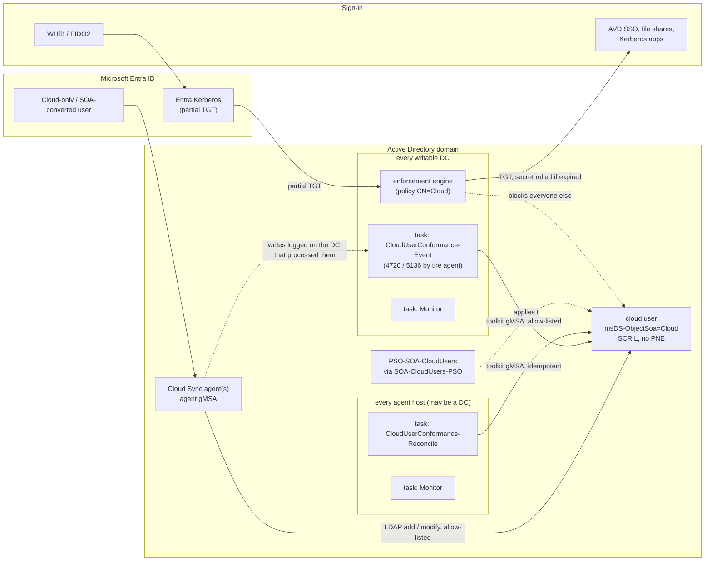

# cloudsync-soa-toolkit

**Passwordless and always able to sign in: cloud users in Active Directory, provisioned by Microsoft Entra Cloud Sync and protected by AD object enforcement.**

> **Status: 2.0.0 (2026-10-20).** Microsoft Entra Cloud Sync *Entra ID → AD provisioning* and *AD object enforcement* are **preview** features; behaviour and documentation can change. This is an independent community project, not affiliated with or endorsed by Microsoft. Validate in a lab first. There is no warranty (see [License](#license)). Statements are labelled **Documented**, **Observed** or **Inferred** (see [Key findings](#key-findings)).

---

## Contents

- [Executive summary](#executive-summary)
- [What the toolkit does](#what-the-toolkit-does)
- [What it deliberately does not do](#what-it-deliberately-does-not-do)
- [Target state](#target-state)
- [Architecture](#architecture)
- [Repository layout](#repository-layout)
- [Quick start](#quick-start)
- [Terminology](#terminology)
- [Key findings](#key-findings)
- [SCRIL, password expiry and automatic rolling](#scril-password-expiry-and-automatic-rolling)
- [Upstream issues in Microsoft's scripts and documentation](#upstream-issues-in-microsofts-scripts-and-documentation)
- [Open questions and verification status](#open-questions-and-verification-status)
- [References](#references)
- [Authors, contributing, license](#authors-contributing-license)

Further documentation: [docs/SETUP.md](docs/SETUP.md) (what Microsoft documents vs. what the toolkit does, step-by-step setup), [docs/OPERATIONS.md](docs/OPERATIONS.md) (the three primary tasks, topology, monitoring, rollback and decommissioning), [CHANGELOG.md](CHANGELOG.md), [docs/Consolidated-Findings.pdf](docs/Consolidated-Findings.pdf).

---

## Executive summary

**The problem.** Microsoft Entra Cloud Sync can provision cloud-only users, and users whose source of authority (SOA) was converted to the cloud, into Active Directory. These users never know an AD password: they sign in passwordless with Windows Hello for Business or FIDO2 keys via Cloud Kerberos Trust, and use Azure Virtual Desktop single sign-on. Their AD account still has a password that ages, expires and can be attacked. An **expired AD password blocks the passwordless Kerberos sign-in** *(Documented)*.

**The solution in one sentence.** Make these accounts *smart-card-only* (SCRIL), let the domain controllers rotate the hidden secret by themselves at the first passwordless sign-in after expiry (automatic NTLM secret rolling), control the rolling interval with one fine-grained password policy, and freeze the result with AD object enforcement.

**Why this works.**
- The behaviour was measured in a domain with the previews, not assumed:
  - setting SCRIL replaces the password with a random secret;
  - with automatic rolling enabled, SCRIL secrets expire on schedule;
  - a WHfB / FIDO2 sign-in via Cloud Kerberos Trust, with AVD SSO and access to an AD file share, succeeded after expiry, and the DC rolled the secret during that sign-in.
- Everything that keeps users signing in is native AD functionality. The toolkit only establishes and monitors it.

**What the toolkit adds.**
- An idempotent, reversible setup.
- Configuration of every new or converted cloud user within seconds of provisioning, from **every** writable DC, with no management server and no single point of failure.
- A periodic reconcile as a safety net.
- Read-only monitoring for your monitoring system / SIEM.
- Repeatable acceptance tests.
- A step-by-step rollback to the original state.

## What the toolkit does

| Capability | How | Script |
|---|---|---|
| **Check prerequisites** | Per writable DC: enforcement engine (`ntdsai.dll`, KIR feature overrides, RSoP, restart, container origin), plus toolkit prerequisites (topology, automatic rolling, modules, OUs, test user). Read-only. | `Test-SoaPrerequisites.ps1` |
| **Set up the domain** | gMSA, "Log on as a batch job" GPO, KIR enablement GPO from Microsoft's package, diagnostics GPO, audit policy / SACL, automatic rolling, enforcement policy, groups, PSO, least-privilege delegation, allow-list, tasks on every toolkit host, initial conformance, mode switch | `Install-SoaToolkit.ps1` |
| **Bring existing users into the target state** | One call analyses all marked cloud users (read-only report), then applies SCRIL, clears "password never expires" and assigns the PSO. Supports `-WhatIf`; works under Enforced because it runs as the allow-listed gMSA. | `Install-SoaToolkit.ps1 -Step Conform` → `Invoke-CloudUserConformance.ps1` |
| **Onboard new users continuously** | A scheduled task on **every writable DC** starts on event 4720 (user created) or 5136 (`msDS-ObjectSoa` written), in both cases only when the Cloud Sync agent is the writer. The event only triggers the run; the run reads the actual state from AD and processes every deviation. | `Invoke-CloudUserConformance.ps1 -Trigger Event` |
| **Repair drift** | Reconcile task on every agent host, staggered; idempotent; writes only on deviation. Removes users that are out of scope from the PSO group. | `Invoke-CloudUserConformance.ps1 -Trigger Schedule` |
| **Monitor** | Read-only checks per host role and domain-wide, results to the event log `SoaToolkit` (2000 heartbeat / 2001 warning / 2002 failure), exit code 0/1/2, JSON / HTML | `Watch-CloudUserConformance.ps1` |
| **Assess the enforcement impact** | Who changed marked objects recently and would be blocked in Enforced mode | `Get-SoaEnforcementImpact.ps1` |
| **Prove the behaviour** | SCRIL matrix, automatic rolling with a real passwordless sign-in, onboarding, enforcement, logon. Writes only to the test user. | `Test-SoaBehavior.ps1` |
| **Toggle diagnostics** | GPO for NTDS diagnostics `2 Security Events` (events 3095/3097/3098). Can also be used on its own. | `Set-SoaDiagnosticsGpo.ps1` |
| **Roll back** | Step by step or by preset (`Decommission` / `Full`), driven by the install manifest. Never removes objects that existed before. | `Uninstall-SoaToolkit.ps1` |

Every object the toolkit creates carries the marker **`[SoaToolkit] Managed by SOA Toolkit - do not modify manually`** and a link to this repository. The marker is placed in the `description` / `info` attribute, the GPO comment, the WMI filter description, the task description and the file header. Changes to toolkit objects are detected by the monitoring.

## What it deliberately does not do

- **No password rotation.** The domain controllers roll the secret themselves (automatic rolling). The toolkit never knows, sets or stores a user password.
- **No change outside the scope.** Only users with the anchor `User_*` **and** `msDS-ObjectSoa = Cloud` are changed, and only the bits SCRIL / "password never expires". SCRIL is never removed automatically.
- **No non-LDAP or DC-internal write paths.** They are not used and not tested.
- **No Cloud Sync configuration.** Agents, scoping and attribute mappings stay with Microsoft's tooling.
- **No management server.** Code runs only on the domain controllers and agent hosts that are part of the solution anyway.
- **No break-glass account by default.** Recovery is `SetMode Audit`: Domain Admins can always change the policy object. An optional break-glass step exists.

## Target state

| Object | Setting | Reason |
|---|---|---|
| Domain | Domain functional level ≥ 2016, `msDS-ExpirePasswordsOnSmartCardOnlyAccounts = TRUE` | Prerequisites for automatic rolling (K9, K13) |
| Cloud user (`User_*`, `msDS-ObjectSoa = Cloud`) | **SCRIL set** | Random secret; rolled by the DC at sign-in after expiry (K10, K11, K16) |
| | **"Password never expires" cleared** | PNE disables expiry and therefore rolling (K17) |
| | No "user cannot change password" ACEs | No effect (K18) |
| | Member of `SOA-CloudUsers-PSO` | Synced groups are universal and cannot carry a PSO (K19) |
| PSO `PSO-SOA-CloudUsers` (precedence 10) | Max age **30 days** (rolling interval; DISA STIG requires ≤ 60), min age 1 day, **min length 64**, complexity on, history 24, reversible off, **lockout threshold 0** | Lockout would only enable denial of service against accounts whose secret cannot be guessed |
| AD object enforcement | Allow-list = all agent gMSAs + toolkit gMSA; mode **Enforced** after an Audit phase | Marked objects can only be changed by the source of authority |

## Architecture



| Function | Runs on | Instances | Why there |
|---|---|---|---|
| Enforcement engine (Microsoft) | every writable DC | 1 per DC | `ntdsai.dll` |
| Onboarding (event-triggered) | every writable DC | 1 per DC | Security events exist only on the DC that processed the write; the agent may use any writable DC |
| Reconcile | every agent host | 1 per agent host, staggered | Domain-wide LDAP; needs no DC |
| Monitoring | every toolkit host | 1 per host | DC-local checks (engine, events), agent-local checks (service), domain-wide checks on agent hosts |
| Setup, rollback, impact, tests | admin workstation (PAW) | – | No permanent footprint |

There is **no single point of failure in the toolkit**. Without rotation, every write is idempotent, so nothing has to run on the PDC emulator or on a single host. Details: [docs/OPERATIONS.md](docs/OPERATIONS.md#topology-and-single-points-of-failure).

## Repository layout

All scripts are in `scripts/` and share `SoaToolkit.psm1` (functions) and `SoaToolkit.config.psd1` (configuration).

| Script | Purpose | Writes |
|---|---|---|
| `Test-SoaPrerequisites.ps1` | Pre-flight: AD object enforcement per DC + toolkit prerequisites | – |
| `Install-SoaToolkit.ps1` | Setup steps (idempotent, `-WhatIf`, manifest) | AD, GPOs, hosts |
| `Uninstall-SoaToolkit.ps1` | Rollback steps / presets | AD, GPOs, hosts |
| `Invoke-CloudUserConformance.ps1` | Target state: `Analyze` (read-only) / `Apply` (tasks) / `Test` (TestUser only) | cloud users, PSO group |
| `Watch-CloudUserConformance.ps1` | Monitoring: `-Scope Local` (tasks) / `-Scope All` (interactive) | event log / reports |
| `Test-SoaBehavior.ps1` | Acceptance tests (suites) | TestUser only |
| `Get-SoaEnforcementImpact.ps1` | Impact of Enforced mode | – |
| `Set-SoaDiagnosticsGpo.ps1` | Diagnostics GPO (can also be used on its own) | GPO |
| `SoaToolkit.psm1` | Shared functions | – |
| `SoaToolkit.config.psd1` | Configuration (placeholders: `contoso.com`) | – |

Naming scheme: `Soa*` = toolkit, infrastructure and Microsoft's feature. `CloudUser*` = the target state of the users. Verbs: `Test` = check / test, `Get` = report, `Set` = single setting, `Install` / `Uninstall` = setup / rollback, `Invoke` = changes users, `Watch` = monitoring.

## Quick start

```powershell
# admin workstation, Domain Admin, RSAT; scripts\SoaToolkit.config.psd1 adjusted (see docs/SETUP.md)
.\Test-SoaPrerequisites.ps1
.\Install-SoaToolkit.ps1 -Step All -KirMsi2025 C:\Install\AD-Enforcement-WS2025.msi -WhatIf
.\Install-SoaToolkit.ps1 -Step All -KirMsi2025 C:\Install\AD-Enforcement-WS2025.msi -Refresh
#   restart the writable DCs one at a time, then
.\Install-SoaToolkit.ps1 -Step Policy, AllowList, DeployTasks, Verify
.\Test-SoaBehavior.ps1 -Suite Inventory, Scril, Onboarding
.\Install-SoaToolkit.ps1 -Step Conform -WhatIf      # analysis only
.\Install-SoaToolkit.ps1 -Step Conform
.\Get-SoaEnforcementImpact.ps1
.\Install-SoaToolkit.ps1 -Step SetMode -Mode Enforced
.\Test-SoaBehavior.ps1 -Suite Enforcement, Logon
.\Watch-CloudUserConformance.ps1 -Html
```

The full procedure, including the manual steps after the download: **[docs/SETUP.md](docs/SETUP.md)**.

## Terminology

| Term | Meaning |
|---|---|
| **Provisioned user** | AD user created or taken over by Cloud Sync; `msDS-ExternalDirectoryObjectId` starts with `User_` |
| **Marked** | `msDS-ObjectSoa = Cloud` (default user mapping); the enforcement policy applies only to marked objects |
| **In scope** | Provisioned **and** marked, not excluded (group `SOA-CloudUsers-Exclude`, `ExcludeOUs`, break-glass), and member of the pilot group if `PilotMode` is on |
| **Cloud-native** / **SOA-converted** | Origin heuristic: the anchor was stamped within 10 minutes of object creation (created by provisioning) or later (pre-existing object taken over) |
| **Enforcement policy** | `CN=Cloud,CN=SOA-Policies,CN=System,<domain>`; `keywords` = mode (`Audit` / `Enforced`), `msDS-Settings` = allow-list (SIDs) |
| **Enforcement engine** | DC component (cumulative update + KIR feature enablement) that evaluates the policy on every LDAP write |
| **Policy load event** | Event 3095 (Directory Service log); 3097 = would be blocked (Audit), 3098 = blocked (Enforced) |
| **Agent gMSA** / **toolkit gMSA** | Identity of the Cloud Sync provisioning agent / of the toolkit tasks (`gmsaSoaToolkit`); both are allow-listed |
| **SCRIL** / **PNE** | *Smart card is required for interactive logon* (UAC 0x40000) / *Password never expires* (UAC 0x10000) |
| **Deny-change ACEs** | *User cannot change password*: deny ACEs on the *Change Password* extended right (not a UAC flag) |
| **Secret** | The AD password secret (`unicodePwd`). Changes are detected through the replication metadata version; the value is never read |
| **Automatic rolling** | DC-side re-randomization of an expired SCRIL secret at sign-in (MS-SAMS); needs DFL ≥ 2016 and `msDS-ExpirePasswordsOnSmartCardOnlyAccounts` |
| **Onboarding** / **Reconcile** | Event-triggered run on a writable DC / scheduled run on an agent host. Same code, same target state |
| **Marker** | `[SoaToolkit] Managed by SOA Toolkit - do not modify manually` on every object the toolkit creates |
| **Manifest** | `<ReportPath>\State\manifest.json`: what the setup created or changed, incl. previous values (basis of the rollback) |
| **KIR override** | Feature override under `HKLM\SYSTEM\CurrentControlSet\Policies\Microsoft\FeatureManagement\Overrides`, written by the KIR enablement GPO |
| **TestUser** | User created in Entra ID and provisioned by Cloud Sync; the only account the tests write to |

## Key findings

Evidence levels: **Documented** = Microsoft documentation, protocol specification or Microsoft source code. **Observed** = observed in a domain with the previews (Windows Server 2025 DCs, DFL 2025, two writable DCs that are also agent hosts). **Inferred** = derived from the above.

| # | Finding | Evidence |
|---|---|---|
| K1 | Entra ID → AD provisioning has no password writeback; provisioned users are meant to use passwordless Kerberos (WHfB / FIDO2 with Cloud Kerberos Trust). [R1][R2] | Documented |
| K2 | An expired AD password blocks FIDO2 and WHfB Cloud Kerberos Trust sign-in. [R10] | Documented |
| K3 | Specification text: the computed *password expired* bit is never set while SCRIL or PNE is set [R14]; MS-SAMR returns "never must change" for SCRIL. This describes domains **without** automatic rolling. See K16. | Documented |
| K4 | The default user mapping writes `msDS-ObjectSoa = Cloud`; provisioned users are marked automatically. [R5][R6] | Documented |
| K5 | Enforced mode blocks LDAP modify, modify DN and Recycle Bin restore for identities that are not on the allow-list; add and delete are allowed (preview). [R6] | Documented |
| K6 | One unresolvable SID in `msDS-Settings` makes the whole policy fail to load. Maximum 64 SIDs. [R6] | Documented |
| K7 | A direct `userAccountControl` attribute mapping is not applied by the agent; `accountDisabled` toggles only bit 0x2 and preserves other bits (for example SCRIL). | Observed |
| K8 | *User cannot change password* is an ACL, not a UAC flag. [R15] | Documented |
| K9 | Automatic rolling requires the rolling attribute, DFL ≥ 2016, SCRIL, **no PNE**, and an expired password; it writes a new random secret and sets `pwdLastSet`. [R13] | Documented |
| K10 | A WHfB / FIDO2 sign-in via Cloud Kerberos Trust, followed by AVD SSO and access to an AD file share, **succeeded after expiry, and the DC rolled the secret during that sign-in**. | Observed |
| K11 | Setting SCRIL (off → on) re-randomizes the secret but does **not** update `pwdLastSet`; writing the unchanged value again or clearing SCRIL does not re-randomize; a random reset moves `pwdLastSet`. [R17] | Observed |
| K12 | No toolkit rotation is needed: with a PSO max age of 30 days, the secret of every active user is rolled by the DC at the first sign-in after expiry. Idle accounts keep an expired secret, which is also no longer usable for NTLM network logons. | Observed (rolling) / Inferred (idle accounts) |
| K13 | A domain installed at DFL 2016 or higher has the rolling attribute enabled by default [R18]; the attribute was `TRUE` in the test domain. | Documented (third party) / Observed |
| K14 | The KIR "Feature Preview" package switches several feature IDs at once (`enabledList`). | Observed |
| K15 | With AVD SSO the default session-lock behaviour (disconnect) supports FIDO2; the remote lock screen does not. [R12] | Documented |
| K16 | **With automatic rolling enabled, SCRIL secrets expire on schedule**: `msDS-UserPasswordExpiryTimeComputed` returns a date and the PE flag is set at expiry. The passwordless sign-in still works and triggers rolling (K10). | Observed |
| K17 | PNE makes the computed expiry "never", so **PNE disables automatic rolling**. | Observed |
| K18 | Deny-change ACEs do not change the randomization when SCRIL is set. | Observed |
| K19 | Groups provisioned by Cloud Sync are universal [R9]; fine-grained password policies apply only to users and global groups [R29], which is why the toolkit uses an AD-native global group. | Documented |
| K20 | Microsoft supports the agent on a DC or a member server, recommends hardening the agent host as Tier 0, and recommends 3 active agents. The documentation does not say which DC an agent writes to. [R27] | Documented |
| K21 | Events 4720 / 5136 are logged only on the DC that processed the write [R30][R21]. That is why onboarding runs on every writable DC. | Documented / Inferred |

## SCRIL, password expiry and automatic rolling

| State (per user) | Computed expiry / PE | Secret changes through | Risk for passwordless sign-in |
|---|---|---|---|
| no SCRIL, no PNE | expires after max age | – | **High**: blocked after expiry (K2) |
| no SCRIL, PNE | never | – | Low, but a usable password may exist |
| SCRIL, no PNE, rolling **off** | never (K3) | only when SCRIL is set | Low; the secret never rotates (STIG V-243476 not met) |
| **SCRIL, no PNE, rolling on (target)** | date; PE at expiry (K16) | **DC rolling at the next passwordless sign-in** (K10) | **Low** |
| SCRIL + PNE | never (K17) | only when SCRIL is set | Low; no rotation |

## Upstream issues in Microsoft's scripts and documentation

Versions examined (retrieved **2026-10-19**):

- `Set-CloudSyncSOAPolicy.ps1` at [commit `3f03ef2d`](https://github.com/AzureAD/EntraIDGovernance/blob/3f03ef2d5e63ffd084ec4b9deac495e3bf1215e6/Set-CloudSyncSOAPolicy.ps1) (2026-05-26). Repository HEAD `ce9c023c53e0e47a93d7ca12042032a2acabf96d`. SHA-256 `d23e36a8e79e3d081c6b6dcd09a354933370bf9527cb68f9ce0d2d33f10f0baf`.
- `Check-CloudSyncSOAPolicy.ps1` at [commit `0afc4332`](https://github.com/AzureAD/EntraIDGovernance/blob/0afc4332aa9f73b22607854cf4a7c77b608fc7aa/Check-CloudSyncSOAPolicy.ps1) (2026-06-04). SHA-256 `66a7864476a34587c34f80b9c805f0ac22da0b01d0ffcb286416afef22fb7b97`.
- Documentation [Configure AD user and group enforcement (preview)](https://learn.microsoft.com/en-us/entra/identity/hybrid/cloud-sync/how-to-active-directory-object-enforcement): docs commit `e12ee338`, `ms.date` 2026-08-11, last updated 2026-08-28; re-checked 2026-10-20.

| ID | Type | Documentation says | Script actually does | Impact | Handled by |
|---|---|---|---|---|---|
| **F1** | Defect (docs ↔ code) | "To change the mode, run `Set-CloudSyncSOAPolicy.ps1` again with the new value for `-EnforcementMode`." | If `CN=Cloud` exists, it prints `already exists. No changes were made.` and returns (lines 153–161); `keywords` is only written on creation (line 166) | The documented mode switch, **including an emergency rollback to Audit**, does nothing | `Install-SoaToolkit.ps1 -Step SetMode`, `Uninstall-SoaToolkit.ps1 -Step SetModeAudit` |
| **F2** | Design issue | "The PDCe automatically creates the `SOA-Policies` container" | Creates the container itself if it is missing (lines 142–151) | Masks the best indicator of an inactive engine on the PDCe | `Install-SoaToolkit.ps1 -Step Policy` never creates the container; `Test-SoaPrerequisites.ps1` reports the originating DC |
| **F3** | Docs ↔ code | The check script "reports whether the policy is enabled on that domain controller" | Reads only domain-wide objects and the local diagnostics value | False confidence about per-DC enablement | `Test-SoaPrerequisites.ps1`, monitoring (`ntdsai.dll`, KIR overrides, event 3095 per DC) |
| **F4** | Code assumption | – | Looks up the agent gMSA at the fixed DN `CN=provAgentgMSA,…` (line 34) | False "NOT FOUND" for other gMSA names | Agent gMSA resolved from the agent service on every agent host |
| **F5** | Terminology | "Set the Security Diagnostics value to `1`" | The value is `NTDS\Diagnostics\2 Security Events` (check script lines 180–191) | Ambiguous instruction | `Set-SoaDiagnosticsGpo.ps1` |
| **F6** | Limitation | "adds the provisioning agent's gMSA SID" | Adds only the gMSA of the **local** agent | Further agents / identities must be added by hand | `Install-SoaToolkit.ps1 -Step AllowList` (all agents + toolkit gMSA, SID validation, 64 limit) |

These findings have not been reported upstream yet. If you can reproduce them, consider opening an issue in the Microsoft repository or using the documentation feedback.

## Open questions and verification status

| Question | Status / how it is answered |
|---|---|
| Does a passwordless sign-in via Cloud Kerberos Trust trigger rolling? (K10) | **Answered: yes** (`Test-SoaBehavior.ps1 -Suite RollingObserve`) |
| Does setting SCRIL update `pwdLastSet` / re-randomize? (K11) | **Answered** (`-Suite Scril`) |
| Does rolling also update `pwdLastSet` (as MS-SAMS says)? | `-Suite RollingObserve` records it (V1); the monitoring flags "rolled but still expired" |
| Does AD accept the compare-and-swap form of the `userAccountControl` update? | Used by `Set-SoaUacFlags`; falls back to replace automatically; the journal records the method used |
| May the toolkit gMSA write to the `SoaToolkit` event log in every environment? | The channel access is set by DeployTasks; check for heartbeat event 2000 after deployment |
| Is the allow-list evaluated for group SIDs in the token? | Not tested; only account SIDs are used |
| DC-internal writes and non-LDAP password paths under enforcement | Out of scope |

## References

Retrieved = date the source was read for this project.

| ID | Source | Version | Retrieved |
|---|---|---|---|
| R1 | [Overview of Microsoft Entra ID to AD provisioning](https://learn.microsoft.com/en-us/entra/identity/hybrid/cloud-sync/overview-provision-entra-id-to-active-directory) | last updated 2026-09-24 | 2026-10-15 |
| R2 | [Tutorial: Govern access to an on-premises app (preview)](https://learn.microsoft.com/en-us/entra/identity/hybrid/cloud-sync/tutorial-users-groups-provisioning-walkthrough) | last updated 2026-08-28 | 2026-10-15 |
| R3 | [How provisioning to AD works (preview)](https://learn.microsoft.com/en-us/entra/identity/hybrid/cloud-sync/how-provisioning-to-active-directory-works) | last updated 2026-08-28 | 2026-10-15 |
| R4 | [Prerequisites for provisioning to AD (preview)](https://learn.microsoft.com/en-us/entra/identity/hybrid/cloud-sync/how-to-prerequisites-provision-entra-to-active-directory) | n/a | 2026-10-15 |
| R5 | [Configure Microsoft Entra ID to AD provisioning (preview)](https://learn.microsoft.com/en-us/entra/identity/hybrid/cloud-sync/how-to-configure-entra-to-active-directory) | last updated 2026-09-24 | 2026-10-15 |
| R6 | [Configure AD user and group enforcement (preview)](https://learn.microsoft.com/en-us/entra/identity/hybrid/cloud-sync/how-to-active-directory-object-enforcement) | ms.date 2026-08-11, last updated 2026-08-28 | 2026-10-15, re-checked 2026-10-20 |
| R7 | [Set-CloudSyncSOAPolicy.ps1](https://github.com/AzureAD/EntraIDGovernance/blob/3f03ef2d5e63ffd084ec4b9deac495e3bf1215e6/Set-CloudSyncSOAPolicy.ps1) | commit `3f03ef2d` | 2026-10-16 |
| R8 | [Check-CloudSyncSOAPolicy.ps1](https://github.com/AzureAD/EntraIDGovernance/blob/0afc4332aa9f73b22607854cf4a7c77b608fc7aa/Check-CloudSyncSOAPolicy.ps1) | commit `0afc4332` | 2026-10-16 |
| R9 | [Tutorial: Provision groups to AD DS](https://learn.microsoft.com/en-us/entra/identity/hybrid/cloud-sync/tutorial-group-provisioning) | last updated 2026-08-31 | 2026-10-15 |
| R10 | [Passwordless security key sign-in to on-premises resources](https://learn.microsoft.com/en-us/entra/identity/authentication/howto-authentication-passwordless-security-key-on-premises) | n/a | 2026-10-15 |
| R11 | [Microsoft Entra Kerberos FAQ](https://learn.microsoft.com/en-us/entra/identity/authentication/kerberos-faq) | n/a | 2026-10-15 |
| R12 | [Configure SSO for Azure Virtual Desktop](https://learn.microsoft.com/en-us/azure/virtual-desktop/configure-single-sign-on) | last updated 2026-06-24 | 2026-10-15 |
| R13 | [MS-SAMS 3.3.5.7.2](https://learn.microsoft.com/en-us/openspecs/windows_protocols/ms-sams/c5d80200-7c4c-4646-8a3b-3df670930555) | current at retrieval | 2026-10-19 |
| R14 | [MS-ADTS msDS-User-Account-Control-Computed](https://learn.microsoft.com/en-us/openspecs/windows_protocols/ms-adts/b80798ae-1f8c-4d30-9d80-a1f3281e96e2) | last updated 2026-08-24 | 2026-10-15 |
| R15 | [Use the UserAccountControl flags (KB 305144)](https://support.microsoft.com/kb/305144) | n/a | 2026-10-15 |
| R16 | [Security Focus: Resetting SCRIL (Microsoft blog archive)](https://learn.microsoft.com/en-us/archive/blogs/poshchap/security-focus-resetting-smart-card-is-required-for-interactive-logon) | archived | 2026-10-15 |
| R17 | [Expire Passwords On Smart Card Only Accounts (secureidentity.se)](https://secureidentity.se/expire-passwords-on-smart-card-only-accounts/) | n/a | 2026-10-19 |
| R18 | [Automatically change passwords for SCRIL / WHfB accounts (Gradenegger)](https://www.gradenegger.eu/en/automatically-change-passwords-for-accounts-that-require-login-via-smartcard-or-windows-hello-for-business/) | n/a | 2026-10-19 |
| R19 | [DISA STIG V-243476](https://www.stigviewer.com/stigs/active_directory_domain/2026-02-11/finding/V-243476) | STIG 2026-02-11 | 2026-10-15 |
| R20 | [Expressions for attribute mappings](https://learn.microsoft.com/en-us/entra/identity/app-provisioning/functions-for-customizing-application-data) | last updated 2026-10-02 | 2026-10-15 |
| R21 | [Event 5136](https://learn.microsoft.com/previous-versions/windows/it-pro/windows-10/security/threat-protection/auditing/event-5136) | previous versions | 2026-10-15 |
| R22 | [Cloud Sync troubleshooting](https://learn.microsoft.com/en-us/entra/identity/hybrid/cloud-sync/how-to-troubleshoot) | n/a | 2026-10-15 |
| R23 | [Known Issue Rollback](https://learn.microsoft.com/troubleshoot/windows-server/installing-updates-features-roles/known-issue-rollback) | n/a | 2026-10-16 |
| R24 | [Passwordless strategy](https://learn.microsoft.com/en-us/windows/security/identity-protection/passwordless-strategy/) | n/a | 2026-10-15 |
| R25 | [Security baseline for Windows 10 / Server v1903 (password expiration dropped)](https://learn.microsoft.com/cs-cz/archive/blogs/secguide/security-baseline-final-for-windows-10-v1903-and-windows-server-v1903) | archived | 2026-10-15 |
| R26 | [Going passwordless with WHfB and SCRIL (Cloudbrothers)](https://cloudbrothers.info/en/going-passwordless-whfb-scril/) | n/a | 2026-10-15 |
| R27 | [Cloud Sync prerequisites](https://learn.microsoft.com/en-us/entra/identity/hybrid/cloud-sync/how-to-prerequisites) (agent on DC supported, Tier 0 hardening, 3 agents, OS lists) | n/a | 2026-10-20 |
| R28 | [Use Group Policy to deploy a Known Issue Rollback](https://learn.microsoft.com/en-us/troubleshoot/windows-client/group-policy/use-group-policy-to-deploy-known-issue-rollback) | n/a | 2026-10-20 |
| R29 | [AD DS fine-grained password policy step-by-step (attribute ranges, applies to users / global groups)](https://learn.microsoft.com/ja-jp/previous-versions/windows/it-pro/windows-server-2008-R2-and-2008/cc754544(v=ws.10)) | previous versions | 2026-10-20 |
| R30 | [Event 4720](https://learn.microsoft.com/fi-fi/previous-versions/windows/it-pro/windows-10/security/threat-protection/auditing/event-4720) / [Audit User Account Management](https://learn.microsoft.com/windows/security/threat-protection/auditing/audit-user-account-management) | n/a | 2026-10-20 |
| R31 | [Configuring Account Lockout (Microsoft security guidance)](https://learn.microsoft.com/fr-fr/archive/blogs/secguide/configuring-account-lockout) | archived | 2026-10-20 |
| R32 | [Securing Domain Controllers Against Attack](https://learn.microsoft.com/en-us/windows-server/identity/ad-ds/plan/security-best-practices/securing-domain-controllers-against-attack) | n/a | 2026-10-20 |

## Authors, contributing, license

- **Licensors / authors:** GEBR. MAYER GmbH + Co. KG (GEBR. MAYER Bautechnik) and Johannes Lämmermann.
- **Contributors:** see [CONTRIBUTING.md](CONTRIBUTING.md).
- **Repository:** https://github.com/mayer-bautechnik/cloudsync-soa-toolkit

### License

Copyright (c) 2026 GEBR. MAYER GmbH + Co. KG and Johannes Lämmermann.

Source code and documentation are licensed under the **[Mozilla Public License 2.0](LICENSE)** (MPL-2.0). In short:
- you may use, modify and distribute the toolkit, also commercially and inside larger proprietary works;
- if you **distribute** modified files of this project, you must make those files available in source form under the MPL-2.0 and keep the license notices (including the copyright line and repository link in the file headers);
- internal use without distribution creates no publication obligation.

This summary is not legal advice; the license text is authoritative. Contributions are accepted under the same license (see [CONTRIBUTING.md](CONTRIBUTING.md)).

*Microsoft, Entra, Active Directory, Windows Hello and Azure are trademarks of the Microsoft group of companies. This project is not affiliated with Microsoft.*
