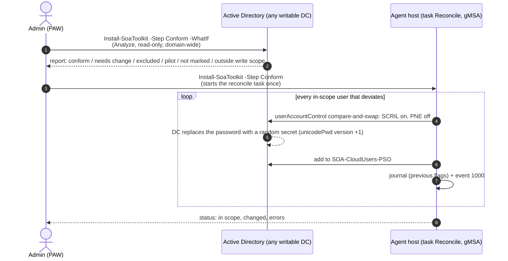
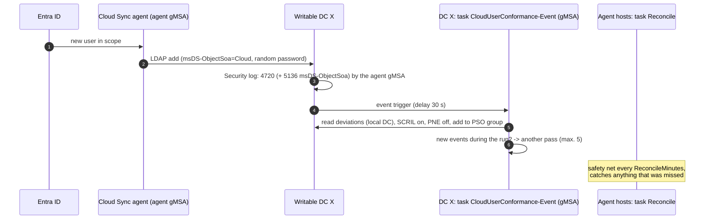
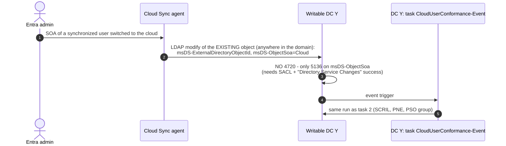

# Operations guide

- [1. Topology and single points of failure](#topology-and-single-points-of-failure)
- [2. The three primary tasks](#the-three-primary-tasks)
- [3. Reconcile: implications](#reconcile-implications)
- [4. What can still deviate under Enforced mode](#what-can-still-deviate-under-enforced-mode)
- [5. Monitoring](#monitoring)
- [6. Rollback and decommissioning](#rollback-and-decommissioning)
- [7. Reports for validation and support](#reports-for-validation-and-support)
- [8. Troubleshooting](#troubleshooting)

---

## Topology and single points of failure

### Supported topologies

Microsoft supports the provisioning agent on a domain controller or on a domain-joined member server (not Server Core), recommends hardening the agent host as a Tier-0 asset, and recommends three active agents for high availability [R27]. The documentation does not say which DC an agent writes to, so **every writable DC can receive the agent's writes**.

The toolkit assigns its functions to **roles**, not to fixed hosts:

| Role | Hosts | Toolkit tasks | Why |
|---|---|---|---|
| **DC** | every writable DC (discovered automatically) | `CloudUserConformance-Event`, `Monitor` (DC checks) | Events 4720 / 5136 exist only in the Security log of the DC that processed the write; the enforcement engine is DC-local |
| **Agent** | every host in `AgentHosts` | `CloudUserConformance-Reconcile`, `Monitor` (agent + domain-wide checks) | Reconcile works domain-wide over LDAP and needs no DC; the agent service is local |
| both | DC that also runs an agent (reference environment) | all three tasks | – |
| none | admin workstation | – (interactive only) | setup, rollback, impact, tests |

The roles are assigned when the tasks are deployed:

| Role assignment | Done by |
|---|---|
| `Install-SoaToolkit.ps1 -Step DeployTasks` registers tasks per role; tasks that no longer match a host's role are removed | DeployTasks |
| The gMSA can be retrieved by `SOA-Toolkit-Hosts` = *Domain Controllers* (nested; RODCs are not part of it) + member-server agent hosts | HostGroup / Gmsa |
| "Log on as a batch job": one GPO on the DC OU; a second GPO on the OUs of member-server agent hosts (security filter `SOA-Toolkit-Hosts`) | BatchLogonGpo |
| Event filter and allow-list contain **all** agent gMSAs (each agent host may use its own gMSA) | DeployTasks / AllowList |

Read-only DCs are ignored: the agent does not write to them and the engine runs on writable DCs only. Multi-domain forests are handled with one deployment (configuration) per domain.

### No single point of failure

| Function | Instances | If one fails |
|---|---|---|
| Onboarding | 1 per writable DC | Only writes processed by that DC are not onboarded immediately; if the DC is down the agent writes elsewhere; the reconcile catches up |
| Reconcile | 1 per agent host, staggered (offset = interval × index / number of agent hosts) | The other agent hosts continue |
| Monitoring | 1 per host | The monitoring system alerts on the missing heartbeat (event 2000) |
| gMSA, groups, PSO, policy | AD objects | replicated |
| Scripts / configuration | local copy per host | integrity check across hosts (hash vs. `deployment.json`) |

**Nothing runs only on the PDC emulator.** In toolkit 1.x a single writer was needed for the password rotation. Without rotation every write is idempotent:
- setting SCRIL twice during replication latency produces two random secrets, which is harmless;
- adding a user to a group twice is a no-op;
- clearing PNE twice changes nothing.

The only PDCe dependency in the solution is Microsoft's own (one-time): the engine on the PDC emulator creates the `SOA-Policies` container.

## The three primary tasks

All three use the same code (`Invoke-CloudUserConformance.ps1`) and the same target state. The task decides only **when** a run starts and **against which DC** it runs.

### Task 1 – Prepare existing users (cloud-only and SOA-converted)



Effects:
- `pwdLastSet` is not changed by setting SCRIL (K11). Users with an old `pwdLastSet` are therefore "expired" at once, and the DC rolls the secret at their next passwordless sign-in (K10, K16).
- **SOA-converted users lose password-based sign-in** (VPN/RADIUS, Wi-Fi PEAP-MSCHAPv2, LDAP bind, RDP or `runas` with password). Use `PilotMode` for waves.

### Task 2 – Configure new cloud-only users continuously



- Latency: seconds.
- A sign-in before SCRIL is set is harmless: the password is valid for 30 / 42 days.
- Cloud Sync's later writes do not conflict with the toolkit. They toggle only bit 0x2 (K7), and the toolkit writes `userAccountControl` with compare-and-swap.

### Task 3 – Configure SOA-converted users continuously



- This is why the toolkit does not limit its scope by OU: converted users stay where they were.
- **Conversion back to AD** (the user is no longer `msDS-ObjectSoa = Cloud`): the reconcile removes the user from the PSO group, **keeps SCRIL** and writes warning 1001. Whether the user needs a password again is an admin decision.

## Reconcile: implications

- **Allow-listed writer.** The toolkit gMSA must be allow-listed permanently. It is needed for onboarding anyway, so the reconcile adds no new identity.
- **Load.** It writes only on deviation. A run without deviations is one LDAP query for the cloud users plus the group memberships.
- **Gross drift is corrected.** Intentional exceptions belong in `SOA-CloudUsers-Exclude`; otherwise the next run restores the target state.
- **Changes are limited** to SCRIL / PNE of in-scope cloud users and the membership of the toolkit's own PSO group. No other attribute and no other group is touched.
- **Errors** (for example a user outside the write scope) produce event 1002 and a failed status; the monitoring alerts.
- **Switch-off.** `ReconcileMinutes = 0` registers the task disabled (`Conform` can still start it once). Onboarding and monitoring remain.

## What can still deviate under Enforced mode

Enforced mode freezes **marked user objects** against LDAP changes by identities that are not on the allow-list. The target state also depends on objects that are not marked:

| Part of the target state | Protected by enforcement? | Protection |
|---|---|---|
| SCRIL / PNE of existing marked users | yes (LDAP writes by identities not on the allow-list) | + monitoring |
| **New users and SOA conversions** | **no**: add is allowed, and Cloud Sync creates users without SCRIL | onboarding + reconcile |
| Allow-listed identities (agent gMSA, toolkit gMSA) | no: they may write; the agent toggles only bit 0x2 | keep the allow-list minimal; monitoring |
| PSO group (AD-native) | no | monitoring (`GRP-DRIFT`, `USR-PSOGROUP`); reconcile corrects membership |
| PSO object, rolling attribute, enforcement policy | no (Tier-0 objects) | monitoring (`PSO-VALUES`, `ROLL`, `POL-*`) |
| Non-LDAP / DC-internal write paths | not tested (out of scope) | – |

## Monitoring

### Outputs

| Output | Content |
|---|---|
| Event log `SoaToolkit` | 1000 user changed, 1001 conformance warning, 1002 conformance error, 1010 run summary; **2000 monitor heartbeat** (overall status + counts), 2001 warning, 2002 failure (one event per check, affected objects listed). The message contains a JSON line with `CheckId`, `Status`, `Objects`. |
| Exit code | 0 = OK / INFO, 1 = WARN, 2 = FAIL (Nagios convention) |
| Files | `DataPath\Status\monitor.json`, `conformance.json`; interactive: CSV / JSON / HTML in `ReportPath\Monitor` |

### Integration

- **Azure Monitor Agent + data collection rule** on the `SoaToolkit` channel, then Log Analytics / Microsoft Sentinel. Analytics rules on 2002, and on the missing 2000 heartbeat per computer for more than 2 × `MonitorMinutes`.
- **Checkmk / PRTG / Zabbix / SCOM**: event-log monitoring of the channel, or a script sensor calling `Watch-CloudUserConformance.ps1 -Scope Local -Quiet` (exit code).
- **Windows Event Forwarding** to a collector.
- Domain-wide checks run on several hosts on purpose (no single point of failure). Deduplicate by `CheckId` + objects.

### Check catalogue (selection)

| CheckId | Meaning |
|---|---|
| `DC-NTDSAI`, `DC-KIR`, `DC-DIAG`, `DC-LOAD`, `DC-3097`, `DC-3098`, `DC-AUDIT` | enforcement engine and logging per DC |
| `TASK-*`, `RECON-STATUS`, `CONF-ERRORS`, `INTEGRITY`, `SIGNATURE`, `BATCH`, `EVENTLOG` | toolkit runtime per host |
| `AGENT-SVC` | provisioning agent service |
| `POL-*` | policy present, mode, allow-list resolvable, agents + toolkit allow-listed, replicated |
| `ROLL`, `PSO-*` | automatic rolling, PSO values / target / precedence |
| `OBJ-*`, `GRP-DRIFT` | toolkit objects incl. marker, GPO link / version, PSO group drift |
| `AUD-SACL`, `AUD-SACL-OTHER` | toolkit SACL entry for `msDS-ObjectSoa` on every write-scope container (FAIL if missing); other rules that also audit these writes (INFO, not relied upon). Only in `-Scope All` |
| `USR-SCRIL`, `USR-PNE`, `USR-PSOGROUP`, `USR-RPSO`, `USR-WRITE`, `USR-LOCKED`, `USR-NOROLL`, `USR-ROLLPLS`, `USR-EXPIRED`, `USR-KERB-0x17/0x12/0x18`, `USR-NEVERREVEAL`, `USR-UNMARKED` | per-user evaluation |
| `CKT-OBJECT`, `CKT-KEYAGE` | Cloud Kerberos Trust |
| `TEST` | latest results of `Test-SoaBehavior.ps1` (interactive scope) |

The scheduled monitor runs as the gMSA, which is not a local administrator. Checks that need administrative rights (effective audit policy, effective batch logon right, SACLs - reading a SACL needs "Manage auditing and security log") are performed by the interactive `-Scope All` run and by `Install-SoaToolkit.ps1 -Step Verify`. Run one of them regularly (e.g. after changes to OUs or audit settings).

## Rollback and decommissioning

### Principles

- Every object the toolkit creates carries the marker. Uninstall removes **only** objects that are recorded as *Created* in the manifest or carry the marker. Pre-existing objects are kept unless `-Force` is used.
- Previous values are recorded in the manifest (first value wins): rolling attribute, policy mode, allow-list, effective batch logon lists, per-DC audit policy.
- The previous flags of every user change are recorded redundantly: the journal on each host, events 1000 (incl. `Before`), and the copy collected by `RemoveTasks`.
- Every step can be run on its own and supports `-WhatIf`.

### Steps (in execution order)

| Step | Effect | Notes |
|---|---|---|
| `SetModeAudit` | enforcement → Audit | marked objects become writable again; no effect on users |
| `StopTasks` | all toolkit tasks disabled | from here on the toolkit writes nothing |
| `RevertUsers` | restores SCRIL / PNE from the journals | **optional, never part of a preset**. Without SCRIL the rolling stops, the password expires and passwordless sign-in fails with 0x17 |
| `RemovePso` | PSO deleted | users fall back to the domain policy; with SCRIL + rolling everything keeps working with the domain `maxPwdAge` |
| `RemoveAllowList` | toolkit gMSA (+ break-glass) removed from `msDS-Settings` | **must run before `RemoveGmsa`** (a stale SID makes the policy fail to load); agent SIDs are kept |
| `RemovePolicy` | `CN=Cloud` deleted (only if created by the toolkit) | enforcement off |
| `RemoveTasks` | journal / status / logs collected to `ReportPath\Uninstall\<host>`, then tasks, folder, scripts, data, event log removed | |
| `RemoveAudit` | toolkit SACL entries (exact fingerprint, only on the containers in the manifest) and audit GPO removed | |
| `RemoveDelegation` | all ACEs of the gMSA (and break-glass), Event Log Readers membership | ACEs on marked objects need Audit mode |
| `RemoveBatchLogonGpo` | batch logon GPO(s) deleted; `-Refresh` verifies and cleans a remaining local entry on member servers | DCs fall back to the Default Domain Controllers Policy |
| `RemoveKirGpo` | KIR GPO(s) + WMI filter(s) deleted; `-RemoveAdmx` deletes unchanged ADMX/ADML | engine off **after the next restart** of each DC |
| `RemoveDiagnosticsGpo` | diagnostics GPO deleted | value removed from the DCs |
| `RemoveGmsa` | gMSA + `SOA-Toolkit-Hosts` deleted | refused while the SID is still allow-listed |
| `RemoveGroups` | PSO / exclusion / pilot groups deleted | |
| `RestoreRolling` | rolling attribute restored | only if the toolkit changed it |
| `RemoveAccounts` | break-glass account deleted | only if the toolkit created it |
| `Verify` | lists everything that still carries the marker | |

### Presets

| Preset | Steps | Result |
|---|---|---|
| `Decommission` | StopTasks, RemoveAllowList, RemoveTasks, RemoveDelegation, RemoveBatchLogonGpo, RemoveGmsa, Verify | The toolkit is gone; target state, PSO, groups, policy and KIR GPO stay |
| `Full` | everything except RevertUsers | Original state as far as possible (users keep SCRIL) |

### What happens when the toolkit is decommissioned

**For existing users: nothing.** SCRIL, DC rolling and the PSO are native AD functions and keep working without the toolkit. There are three consequences:

1. **New users and SOA conversions are no longer configured.** They keep their initial password without SCRIL, and passwordless sign-in fails after the domain `maxPwdAge` with 0x17. Decommission therefore needs another onboarding process, or the full rollback.
2. **The order of the allow-list matters** (`RemoveAllowList` before `RemoveGmsa`). The presets ensure it.
3. **Monitoring and drift repair end.** The PSO group is no longer maintained (in the `Decommission` preset it stays with its current members).

**Not handled by the toolkit** (outside its scope):
- the Cloud Sync configuration and mappings;
- `msDS-ObjectSoa` on users and groups (without a policy it has no effect);
- Windows updates;
- the KDS root key (never delete it);
- pre-existing GPOs, for example a manually created KIR GPO.

## Reports for validation and support

`Export-SoaReport.ps1` collects the validation status (L1-L20) or the data for a bug report into a local folder. It anonymizes identifiers, runs a leak check and packages only after your review. Read-only towards AD and hosts. Details: [REPORTING.md](REPORTING.md).

```powershell
.\Export-SoaReport.ps1                                                     # validation status L1-L20
.\Export-SoaReport.ps1 -Purpose BugReport -Description 'what happened' -Days 7
.\Export-SoaReport.ps1 -Package <folder>                                  # after the review
```

## Troubleshooting

| Symptom | Check |
|---|---|
| Event task never starts | Audit "User Account Management" / "Directory Service Changes" (success) effective? Toolkit SACL entry on the write scope? (`-Step AuditConfig`, `Watch -Scope All` → `DC-AUDIT`, `AUD-SACL`). A broad foreign SACL is not enough once it is removed - the toolkit entry must be present |
| Tasks fail with 0x8007052F / logon failure | gMSA batch logon right (`BATCH`), host in `SOA-Toolkit-Hosts`, `Test-ADServiceAccount` on the host |
| `USR-WRITE` | user outside the write scope: extend `WriteScope` or move the user, then `-Step Delegate, DeployTasks` |
| `USR-NOROLL` | the user signed in while expired but the secret was not rolled. Which sign-in path? Repeat `Test-SoaBehavior.ps1 -Suite RollingObserve` with that path |
| `USR-ROLLPLS` | rolling does not update `pwdLastSet` in your build: every sign-in rolls again; functionally harmless, report it |
| `DC-LOAD` FAIL | stale SID in the allow-list (`POL-SIDS`), `-Step AllowList -RemoveStaleSids` |
| No heartbeat 2000 | event log channel access (set by DeployTasks), task state, gMSA |
