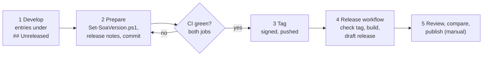

# Releasing

How a version gets from `main` to a published GitHub release. GitHub releases of this repository are **immutable**: once published, the tag and the assets can no longer be changed or deleted. Every check below therefore runs **before** publishing. A mistake found later is fixed with a new version.



## Who does what

| Actor | Part |
|---|---|
| Maintainer | decides the version, runs `tools/Set-SoaVersion.ps1`, commits, tags, reviews and publishes the draft. Nothing is published without this last manual step. |
| AI assistant (optional) | prepares changes and CHANGELOG entries, drafts release notes, runs the static checks and builds the repository zip and a release zip from the same content, for comparison and lab deployment. It does not push, tag or publish. |
| CI (`.github/workflows/ci.yml`) | static checks and tests on PowerShell 7 and Windows PowerShell 5.1 for every push to `main` and every pull request |
| Release workflow (`.github/workflows/release.yml`) | runs when a tag `v<major>.<minor>.<patch>` is pushed: checks the tag, builds the asset, creates a **draft** release. It never changes the repository. |
| GitHub | rulesets for `main` and the release tags, immutable releases, release attestation ([GITHUB-SETTINGS.md](GITHUB-SETTINGS.md)) |

## Version rules

- [Semantic Versioning](https://semver.org/): patch for fixes, minor for new features, major for breaking changes. A published version never changes.
- The version is changed **only** by `tools/Set-SoaVersion.ps1`, at release time. Between releases, `main` carries the last released version; new entries collect in `CHANGELOG.md` under `## Unreleased`.
- Places that carry the version (all set by the script, checked by H6): `$script:SoaVersion` / `$script:SoaReleaseDate` in `scripts/SoaToolkit.psm1`, the `Toolkit:` help line of every script in `scripts/`, the header of `SoaToolkit.config.example.psd1`, the README status line, the keywords of `docs/Consolidated-Findings.pdf`, and the CHANGELOG section. Tools and tests carry no version.

## Phase 1 – Develop

1. Make the change. Add an entry to `CHANGELOG.md` under `## Unreleased` (*Fixed*, *Changed*, *New*), not under a version.
2. Run `.\tools\Invoke-SoaStaticChecks.ps1`.
3. Commit with sign-off (`git commit -s`), push, and check that both CI jobs are green.

## Phase 2 – Prepare the release

1. **Know what is published.** `git fetch --tags origin` and `gh release list`. Never rely on a handover note for this.
2. **Choose the version** (Semantic Versioning, see above).
3. **Write the release notes** `.github/release-notes/v<version>.md` (they can be written before step 4; the script creates a template if the file is missing):
   - first line: `<!-- title: v<version> – <summary> -->` - the release title, at most about 60 characters. It does not render; the release workflow uses it as the title and removes it from the release text;
   - English, GitHub Flavored Markdown, links to `/blob/v<version>/...`;
   - no `TODO-RELEASE-NOTES` marker left (H6 and the release workflow refuse it).
4. **Set the version:**
   ```powershell
   .\tools\Set-SoaVersion.ps1 -Version <x.y.z>            # -WhatIf shows what would change
   ```
   It refuses a version that exists as a tag on origin or as a GitHub release (also a draft), sets the version everywhere, turns `## Unreleased` into `## <version> – <date>` and leaves an empty `## Unreleased` above it, rebuilds the PDF (Python 3 with reportlab), runs the static checks and stages the changed files. It does not commit. Running it again with the same version is safe; use this to repeat the check against origin and GitHub on a release commit that was prepared elsewhere (for example by the AI assistant, with `-SkipRemoteCheck`).
5. Review the diff, commit as `Release <version>` with sign-off, push to `main`.
6. **Wait until both CI jobs are green for this commit.** Do not tag before that.

## Phase 3 – Tag

```powershell
git tag -s v<version> -m "cloudsync-soa-toolkit <version>"      # signed (target state)
git tag -a v<version> -m "cloudsync-soa-toolkit <version>"      # transition: annotated, unsigned (see Signing)
git fetch origin
.\tools\Test-SoaReleaseTag.ps1 -Tag v<version>                  # add -AllowUnsigned during the transition
git push origin v<version>
```

`Test-SoaReleaseTag.ps1` runs the same checks as the release workflow (T1-T8) before the tag leaves your machine. Only the maintainer can push, move or delete release tags (tag ruleset).

## Phase 4 – Release workflow (automatic)

On the pushed tag, `.github/workflows/release.yml`:

1. takes `tools/Test-SoaReleaseTag.ps1` **from `main`** (not from the tag) and checks the tag:
   - T1 name, T2 annotated, T3 SSH signature against `.github/allowed_signers` from `main`, T4 commit on `main`, T5 version, T6 CHANGELOG section, T7 release notes (title line, no TODO marker), T8 no release or draft for the tag yet;
2. builds the asset with `tools/Build-SoaRelease.ps1 -Ref v<version>` - it refuses unless the CI workflow succeeded for the tagged commit - and checks `SHA256SUMS.txt` and the `.sha256` file;
3. creates a **draft** release with the title and notes from the notes file and uploads the zip and the `.sha256`;
4. writes the results to the job summary: checks T1-T8, asset SHA-256, contents digest.

If it fails:

| Situation | What to do |
|---|---|
| CI was not finished when the tag was pushed | wait until CI is green, then *Re-run failed jobs* of the release workflow run |
| A check or the build failed | fix it in a new commit on `main`. Then delete the tag (`git push origin :refs/tags/v<version>`, `git tag -d v<version>`), tag the new commit and push again. Allowed while no release exists. |
| A draft exists but is wrong | delete the draft on the releases page, then as above |
| A published release is wrong | never touch tag or assets - see *If a published release turns out to be broken* |

## Phase 5 – Review and publish

1. Open the draft on the releases page. Check title and text.
2. Open the workflow run and read the job summary: every check PASS (T3 WARN only during the signing transition), asset digest, contents digest.
3. **Compare with an independent build of the same tag.** Build it yourself with `.\tools\Build-SoaRelease.ps1 -Ref v<version>`, or use the release zip the AI assistant supplied with the change. The **contents digest** (SHA-256 of `SHA256SUMS.txt`, printed by the script) must be identical. The zip digest itself can differ between machines, because the deflate implementation differs between .NET versions. This independent zip can also be deployed in the lab before publishing.
4. Compare the digest GitHub shows next to the asset with the `.sha256` file.
5. Set it as the latest release (not a pre-release) and publish. GitHub locks the tag and the assets and creates a release attestation.

## Phase 6 – After the release

- Check that the release is marked *Immutable* and the README renders.
- Nothing to do in the CHANGELOG: the empty `## Unreleased` is already there for the next changes.
- New observations go to `docs/EVIDENCE.md`, validation results to `docs/VALIDATION.md`.

## If a published release turns out to be broken

The release cannot be replaced, and that is intended: users and reviewers rely on a version always meaning the same code.

1. Fix forward: prepare the next patch version with the fix and a *Fixed* entry that names the affected version. Run it through all phases above.
2. GitHub allows editing the title and text of an immutable release. Add one line at the top of the broken release's text: "Superseded by v<new version> because of <problem>; do not use." Do not change the tag, the assets or the file in `.github/release-notes/`.
3. If the problem is security-relevant, also follow [SECURITY.md](../SECURITY.md) (advisory).

## Signing

Target state: commits and release tags are signed with an SSH key of the maintainer (preferably on a hardware key). The public key is in `.github/allowed_signers`, so anyone can verify a tag without GitHub:

```powershell
git -c gpg.ssh.allowedSignersFile=.github/allowed_signers verify-tag v<version>
```

The release workflow verifies the tag against `allowed_signers` taken from `main`. An invalid signature always stops the release. An **unsigned** tag stops it too, unless the repository variable `SOA_ALLOW_UNSIGNED_TAGS` is set to `true` - a transition setting until signing is set up; the run then shows a warning. How to set up signing and remove the variable: [GITHUB-SETTINGS.md](GITHUB-SETTINGS.md#switch-to-signed-commits-and-tags).

## One-time setup

- **GitHub:** rulesets, Actions settings, variable, immutable releases, private vulnerability reporting - step by step in [GITHUB-SETTINGS.md](GITHUB-SETTINGS.md).
- **Release workstation:**
  - Git and the GitHub CLI - `Set-SoaVersion.ps1` and `Test-SoaReleaseTag.ps1` ask origin and GitHub; `Build-SoaRelease.ps1` reads the CI result. Install with `winget install --id GitHub.cli`, then open a new terminal (VS Code: restart it completely, so the integrated terminal sees the new PATH) and run `gh auth login` (GitHub.com, HTTPS, login with a web browser). Check with `gh auth status`;
  - Python 3 with `reportlab` and the DejaVu fonts (or `SOA_FONT_DIR`) for the PDF - or let the AI assistant prepare the release commit and repeat `Set-SoaVersion.ps1` locally;
  - `SoaToolkit.terms.txt` at the top level, created from `SoaToolkit.terms.example.txt` (git-ignored). List company domains, internal host names and other identifiers; `Test-SoaRepoHygiene.ps1` (H5) blocks them, and `Export-SoaReport.ps1` uses the same file for pseudonyms.
- **CI hardening:** actions are pinned to the full commit SHA with the version as a comment (currently `actions/checkout` v6.1.0). Before accepting a new pin from Dependabot, compare the SHA with the release tag in the action's repository (`git ls-remote --tags https://github.com/actions/checkout`).
