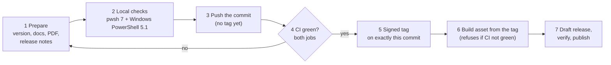

# Releasing

Checklist for the maintainer. GitHub releases of this repository are **immutable**: after publishing, the tag and the assets can no longer be changed or replaced. Every gate below must therefore pass **before** the tag is created and the release is published. A mistake found later can only be fixed with a new version.



## 1. Prepare

1. Set the version and date in `scripts/SoaToolkit.psm1` (`$script:SoaVersion`, `$script:SoaReleaseDate`).
2. Use the same version and date in:
   - the `.NOTES` line of every script in `scripts/`, `tools/` and `tests/`;
   - the configuration header;
   - the README status line.
3. Add a CHANGELOG entry and update the README and docs (status, verification, evidence levels).
4. Rebuild the PDF: `python docs/src/build_findings_pdf.py` (version and date are read from the module).
5. Write the release notes: `.github/release-notes/v<version>.md`. Use English and GitHub Flavored Markdown, with links to `/blob/v<version>/...`. Release notes of published versions are history: never change them afterwards; corrections go into the next version.

## 2. Local checks

```powershell
.\tools\Invoke-SoaStaticChecks.ps1        # from PowerShell 7 on Windows: also runs tests + claims under Windows PowerShell 5.1
```

Everything must pass. The hygiene check (H6) verifies that the version is consistent everywhere. If you run it on Linux or macOS, Windows PowerShell 5.1 is not tested locally, and the CI job is the only 5.1 test.

## 3. Push the commit, without the tag

```powershell
git add -A
git commit -s -m "Release <version>: <summary>"
git push origin main
```

## 4. Gate: CI must be green

Both jobs, *PowerShell 7 - all static checks* and *Windows PowerShell 5.1 - tests and claims*, must succeed **for this commit**. Check in the Actions tab or with the GitHub CLI:

```powershell
gh run list --commit (git rev-parse HEAD) --json name,status,conclusion
```

If a job fails, fix it, commit again and wait for green. Do not create a tag before that.

## 5. Signed tag on exactly this commit

```powershell
git tag -s v<version> -m "cloudsync-soa-toolkit <version>"     # tag.gpgsign = true signs automatically
git push origin v<version>
git verify-tag v<version>                                       # needs gpg.ssh.allowedSignersFile
```

A tag that has been pushed but **not yet released** may still be deleted and recreated if a problem shows up (`git tag -d v<version>`, then `git push origin :refs/tags/v<version>`). Once the release is published, never move or delete the tag.

## 6. Build the asset from the tag

```powershell
.\tools\Build-SoaRelease.ps1 -Ref v<version>
```

- The script asks the GitHub CLI for the CI runs of the tagged commit and **refuses to build** unless all of them succeeded.
- `-SkipCiCheck` exists only for the case that the CLI is unavailable. Then verify CI manually (step 4).
- It creates `cloudsync-soa-toolkit-<version>.zip` from `git archive` of the tag (`export-ignore` paths are left out), with `SHA256SUMS.txt` inside and a `.sha256` file next to it.

## 7. GitHub release

1. *Draft a new release*, then choose the **existing** tag `v<version>`. If GitHub creates the tag itself, it is an unsigned lightweight tag.
2. Title: `v<version> – <short summary>`, at most about 60 characters.
3. Text: content of `.github/release-notes/v<version>.md`.
4. Upload the zip, then compare the digest GitHub shows with the `.sha256` file.
5. **Last check before publishing:** CI of the tagged commit is green, the tag is signed, the digest matches.
6. Set as the latest release, not a pre-release. Publish.

## 8. After the release

- Check that the README renders, the release is marked *Immutable* and the asset digest matches.
- New observations go to `docs/EVIDENCE.md`. Validation results are recorded in `docs/VALIDATION.md`.

## If a published release turns out to be broken

The release cannot be replaced, and that is intended: users and reviewers rely on a version always meaning the same code.

1. Fix it forward: prepare a patch version with the fix and a *Fixed* entry that names the affected version. Run it through all gates above.
2. In the broken release, edit **only the release text**, if GitHub allows it for immutable releases. Add a line at the top: "Superseded by v<new version> because of <problem>; do not use." Do not change the tag, the assets or the file in `.github/release-notes/`.
3. If the problem is security-relevant, also follow [SECURITY.md](../SECURITY.md) (advisory).

## One-time setup (maintainer)

- **Signing:** SSH signing key (preferably on a hardware key), uploaded to GitHub as a *Signing Key*. Publish the public key in `.github/allowed_signers`, so anyone can verify tags without GitHub:
  ```
  git -c gpg.ssh.allowedSignersFile=.github/allowed_signers verify-tag v<version>
  ```
- **Repository settings:**
  - branch protection on `main`: signed commits, both CI jobs required as status checks, no force pushes;
  - immutable releases on;
  - private vulnerability reporting on;
  - Dependabot for GitHub Actions: `.github/dependabot.yml` is in the repository. Enable *Dependabot version updates* if it is not active, and review its pull requests like any other change.
- **CI hardening:** actions are pinned to the full commit SHA with the version as a comment (currently `actions/checkout` v6.0.0, Node.js 24). Before accepting a new pin, compare the SHA with the release tag in the action's repository.
- **GitHub CLI** (`gh auth login`) on the release workstation, for the CI gate in step 6.
- **Terms file:** create `SoaToolkit.terms.txt` at the top level from `SoaToolkit.terms.example.txt`. It is git-ignored. List company domains, internal host names and other identifiers; `Test-SoaRepoHygiene.ps1` (H5) then blocks them, and `Export-SoaReport.ps1` uses the same file for pseudonyms.
