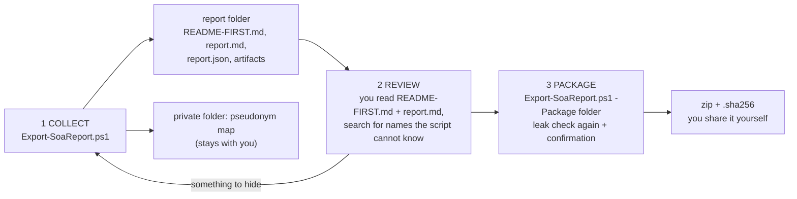

# Reports and bug reports from your environment

`scripts/Export-SoaReport.ps1` collects lab validation results (L1-L20) or the data for a bug report into **one folder on your workstation**. It replaces identifiers by pseudonyms and packages the folder only after you have reviewed it. Nothing is sent anywhere. You decide what you share and with whom.

## The process

| Phase | Command | Result |
|---|---|---|
| Record a manual result | `.\Export-SoaReport.ps1 -Record L16 -Result PASS -Note '...'` | `<ReportPath>\Validation\manual-results.json` |
| Collect (validation) | `.\Export-SoaReport.ps1 [-AdditionalTerms 'Contoso','Springfield']` | `<ReportPath>\Export\SoaReport_Validation_<time>\` |
| Collect (bug report) | `.\Export-SoaReport.ps1 -Purpose BugReport -Description '...' -Days 7` | `...\SoaReport_BugReport_<time>\` |
| Package | `.\Export-SoaReport.ps1 -Package <folder>` | `<folder>.zip`, `<folder>.zip.sha256` |
| List the checks | `.\Export-SoaReport.ps1 -ListChecks` | console |

Run it as Domain Admin from the admin workstation, the same way as `Watch-CloudUserConformance.ps1 -Scope All`. It reads AD and contacts the toolkit hosts over WinRM. It does not change AD, GPOs or hosts. Its only writes are the report folder, the private map and, with `-Record`, the manual results file.

## What is collected

| Source | Content |
|---|---|
| AD (read) | domain and forest mode, rolling attribute, DCs (OS, site), policy mode and allow-list size, PSO values, number of provisioned / marked users; for users in the toolkit journals: creation time and anchor time (origin, latency) |
| `ReportPath` | latest prerequisites checks, latest monitor report (`-ExcludeUserDetails` drops the per-user rows), test results and findings, impact summary, install / uninstall run logs, manifest, manual results, configuration |
| Each toolkit host (WinRM) | OS build and latest updates, PowerShell version, provisioning agent version and state, hashes of the deployed scripts, scheduled tasks; `SoaToolkit` events: counts and the last 40 non-heartbeat events. On DCs only counts: events 3095/3097/3098, plus the writers of 4720 and of 5136 on `msDS-ObjectSoa`. Also the conformance journals and status files, and the last 200 lines of recent run logs |
| Admin workstation | PowerShell and module versions; hashes of the scripts compared with `SHA256SUMS.txt` of the release |

**Never collected:**
- passwords, password hashes or any secret attribute (claim S1 in [SECURITY.md](../SECURITY.md));
- the user list of the domain (only users that appear in the toolkit's own journals and reports);
- GPO contents;
- messages of other event logs than `SoaToolkit`.

## Anonymization

The same original always gets the same pseudonym within one report.

| Original | Pseudonym |
|---|---|
| domain DNS name, its DN form, NetBIOS name | `corp.example`, `DC=corp,DC=example`, `CORP` |
| domain controllers / other hosts (FQDN and short name) | `dc01.corp.example` / `host01` |
| users in the toolkit data (sAMAccountName, name, UPN) | `user001` ... |
| `DOMAIN\account` (also in JSON), the account running the script | `CORP\account001` ... |
| gMSAs | `gmsa01$` ... |
| `CN=` / `OU=` values of DNs | `object001` / `OU-001` (well-known containers and the toolkit's default names stay readable) |
| domain SIDs | `S-1-5-21-1000000000-0-0-<RID>` (RIDs stay, e.g. 512) |
| GUIDs | `00000000-0000-4000-8000-...` (the schema / audit / CSE GUIDs of the toolkit stay) |
| e-mail addresses, IPv4 addresses, user profile paths | `mail001@example.invalid`, `192.0.2.x`, `C:\Users\profile01` |
| AD site names and your `-AdditionalTerms` / `-TermsFile` | `term001` ... |

**Limits:**
- The script can only replace names it knows. Company, product, project, city and person names in free text (for example in notes or descriptions) must be added with `-AdditionalTerms`. That is why phase 2 is a human review.
- OS builds and versions stay. They are needed for the analysis.
- Four-part version numbers whose parts are all ≤ 255 may be shown as `192.0.2.x`.

**Leak check:** after collection and again before packaging, every file is searched for every original value of the map and for patterns of real identifiers: domain SIDs, GUIDs outside the keep list, e-mail addresses. Packaging is refused while hits remain (`-Force` overrides). The findings are listed masked in README-FIRST.md.

**The map** (`<OutputPath>\private\<folder>.map.csv`) lets you answer questions about the report ("which DC is dc02?"). It never goes into the package. Delete it when the case is closed.

`-NoAnonymize` writes original values for internal use. The folder is marked `NOT-ANONYMIZED.txt`, and packaging is refused without `-Force`.

## Review checklist (also in README-FIRST.md)

1. Does `report.md` match what you did?
2. Search all files for company, product, project, site, city and person names, internal URLs and IP ranges. If you find any, collect again with `-AdditionalTerms`.
3. Look at `artifacts\SoaToolkit.config.psd1` and `artifacts\manifest.json` (OU and group names).
4. Delete files you do not want to share. The report stays usable.
5. Package.

## Raw reports of the other scripts

`Test-SoaPrerequisites.ps1`, `Watch-CloudUserConformance.ps1`, `Get-SoaEnforcementImpact.ps1` and `Test-SoaBehavior.ps1` write HTML / CSV / JSON reports for **internal** use. They contain domain, host and user names. Do not share them directly. `Export-SoaReport.ps1` includes their content in anonymized form, and the scripts point this out when they finish.

## Where to send it

| Kind | Channel |
|---|---|
| Lab validation result | GitHub issue form *Lab validation result*, or directly to the maintainer |
| Bug | GitHub issue form *Bug report* (the issue text describes the problem; attach the zip) |
| Question or idea | GitHub issue form *Question or idea* (no environment data needed) |
| Security-relevant finding | **private** vulnerability report ([SECURITY.md](../SECURITY.md)), never a public issue |
